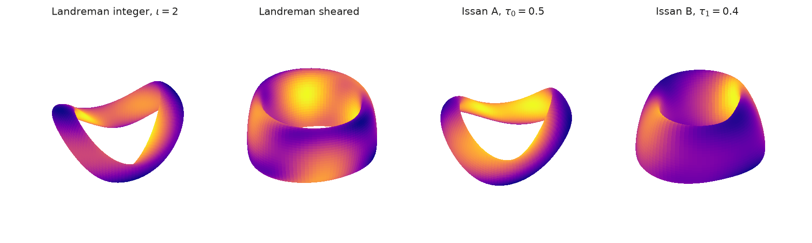

# Testing MHD equilibrium codes against exact solutions

VMEX, VMEC2000, VMEC++ and DESC are scored against 3-D equilibria known in closed form: Landreman's integer and sheared families, the Issan asymmetric extensions, two Solov'ev tokamaks and the Lopez vacuum configuration D. B, J, pressure and flux surfaces are known exactly, including at the axis, so an error shared by every resolution or every code still shows. Verification only: no claim about stability, confinement or experiments.



*Four of the exact boundaries, coloured by |B|. The two on the right break stellarator symmetry.*

## Findings

Each finding has a status label and index records in [CLAIMS.md](CLAIMS.md); everything is scored with one norm (relative L2 over the whole volume, exact-chart points).

- **References and projections hold.** Exact fields, quadrature and derivatives agree to 1e-13 or better. Sheared A and sheared Issan project onto the VMEC basis within B 1e-5, J 1e-3, force 1e-3 from NS 33 and (mpol, ntor) = (13, 12); integer 3-D and Solov'ev floors are 1e-7 to 1e-9 at NS 129 (figure 1).
- **Axisymmetric Solov'ev converges in VMEX and VMEC2000, but not to the floor.** Both reach fsq 1e-14; the B error stays near 1e-5, 180 to 10^4 times the projection floor, and does not fall with NS. Cause: the spectral-condensation constraint is built around a baseline the exact state does not satisfy. With the baseline set to the exact state, B falls roughly as NS^-1.5, to 1.9e-6 at NS 129 (figures 2, 5).
- **3-D cases do not converge from a cold start.** Integer 3-D, tau = +-0.5 and sheared A exhaust 20000 iterations at fsq 1e-9 to 1e-12; the best B is 2e-4. Sheared A is recovered only from the exact seed. At the exact seed the flow Jacobian has 133 to 191 unstable eigenvalues (integer 3-D, default constraint) against one with the exact baseline (figures 2, 6).
- **Asymmetric seeds need VMEC's polar angle.** An unrotated exact seed is sheared against its interior; rotating it removes the iteration-1 residual (7.8e-4 to 5e-8). The earlier "plateau at rational transform" is withdrawn. The tau = +-0.5 error at NS 33-129 is not explained.
- **Lopez D (iota = 1).** Nested VMEX and VMEC2000 solves end at 1e-3 at best from a valid seed and 1e-2 from a cold start; iota = 1 is not the cause, and the earlier "exact-seed" runs were cold starts. A non-nested MRX vacuum solve recovers the field to 1e-6 (exact foliation) and 4e-5 (VMEC deck chart) (figures 1, 2).
- **Sensitivities.** The derivative machinery is certified at NS 17-257. Bulk (s >= 0.1) responses of the nonzero and null parameters pass their gates from NS 129; whole-volume responses fail because of a near-axis layer; the 3-D response is O(1) wrong (figure 4).
- **DESC.** Converges spectrally on Solov'ev (7e-13 at M = 12) and the integer families; sheared A stops at its iteration cap, and the published protocol passes its own checks (figure 2).
- **Cost.** VMEC2000 is 1.1 to 2.7 times faster than VMEX on clean symmetric points; on loaded points the ratio is unresolved (figure 3).
- Two VMEX defects were found and fixed earlier: the axis row ([#452](https://github.com/uwplasma/vmex/pull/452)) and refinement before derivatives ([#453](https://github.com/uwplasma/vmex/pull/453)).

## Paper figures

All six are drawn by `benchmarks/paper_figures.py` from the files listed in [`results/index.json`](results/index.json) (path and sha256 per record), and nothing else. Each is a PNG with a PDF beside it in `figures/paper/`.

1. [References and projection convergence](figures/paper/fig1_references_projection.png): certificate ladders against NS and angular resolution, Lopez D projection, MRX ladder.
2. [Recovery matrix](figures/paper/fig2_recovery_matrix.png): solved error against the projection floor by case, code and protocol, DESC ladders, Lopez D.
3. [Work-precision](figures/paper/fig3_work_precision.png): time to error, with the office load caveat.
4. [Sensitivities](figures/paper/fig4_sensitivities.png): bulk and whole volume, nonzero and null response, 3-D.
5. [Constraint-bias mechanism](figures/paper/fig5_constraint_bias.png): default, exact and zero baseline; dose response; linear attribution.
6. [Seed gauge and flow-Jacobian stability](figures/paper/fig6_seed_gauge_stability.png): iteration-1 residual, solved error, unstable eigenvalue counts.

Older figures in `figures/` (code parity, DESC, Boozer, ripple, tracing, `vmex --plot`) come from `benchmarks/plot_figures.py` and earlier stages. They are integration checks, not part of the claims above.

## Codes

| Code | Identity used | Notes |
|---|---|---|
| [VMEX](https://github.com/uwplasma/vmex) | `caf09ee7` (0.12.0); `3b73d6f` for the earliest runs | JAX VMEC with a continuous field and implicit derivatives |
| [VMEC2000](https://github.com/PrincetonUniversity/STELLOPT) | office build `70c637a`, macOS build `ee17550`; the pinned `3e1439d` is unavailable | reference Fortran code |
| [VMEC++](https://github.com/proximafusion/vmecpp) | 0.5.2 | no `LASYM`; cross-code runs only |
| [DESC](https://github.com/PlasmaControl/DESC) | 0.17.3+32 | pseudo-spectral, Zernike basis |
| [MRX](https://github.com/rogeriojorge/mrx) | fork `732f824` | Lopez D vacuum solve |

Per-experiment pins, platforms and rerun commands: [ENVIRONMENT.md](ENVIRONMENT.md).

## Open problems

Near-axis first-shell layer; whole-volume and 3-D sensitivities; the tau = +-0.5 error at NS 33-129; the weakly unstable 3-D direction; Lopez D limit cycles; Issan family B (not re-examined after the seed-gauge finding). Details: [CLAIMS.md](CLAIMS.md).

## Reproduce

```sh
python -m pip install -r requirements.txt
python -m pytest -q                       # references, index integrity, figure regeneration, no solver
python benchmarks/paper_figures.py        # the six figures, from the index
python benchmarks/verify_reference.py     # force balance of every case and the Issan scans
```

Rescoring from raw states and re-solving: [ENVIRONMENT.md](ENVIRONMENT.md). Raw states (WOUT, `.h5`) are listed with office path and sha256 in [`results/raw_state_manifest.json`](results/raw_state_manifest.json); how to pack them: [RELEASE.md](RELEASE.md).

## Layout

- `benchmarks/analytic.py`: the exact solutions; `build_inputs.py` writes `inputs/`.
- `benchmarks/certify_projection.py`, `score_solved.py`, `common_norms.py`: projection certificate and the common norm set.
- `benchmarks/matrix_*.py`, `desc_matched*.py`, `sensitivity_*.py`, `mech_*.py`, `lopez_*.py`: the experiments of each stage.
- `benchmarks/build_index.py`, `paper_figures.py`, `raw_state_manifest.py`: the paper package.
- `results/`: receipts (input hash, code version, command), scores, `index.json`, `raw_state_manifest.json`. `STATUS.md`: stages and log. Development history: tag `archive-2026-09-25`.

Third-party attribution and the vendored upstream driver: [NOTICE.md](NOTICE.md); licence: `LICENSE`.

## References

- M. Landreman (2026), [arXiv:2609.26742](https://arxiv.org/abs/2609.26742); supplement [landreman/analytic_3d_equilibria](https://github.com/landreman/analytic_3d_equilibria).
- W. Issan, J. Citrin, M. Landreman, B. Tracey (2026), [arXiv:2610.07304](https://arxiv.org/abs/2610.07304).
- Lopez (2026), [arXiv:2610.29921](https://arxiv.org/abs/2610.29921).
- V. V. Nemov, S. V. Kasilov, W. Kernbichler and M. F. Heyn, Phys. Plasmas 6, 4622 (1999).
- S. P. Hirshman and J. C. Whitson, Phys. Fluids 26, 3553 (1983).
- D. W. Dudt and E. Kolemen, Phys. Plasmas 27, 102513 (2020).
