# Testing MHD equilibrium codes against exact solutions

VMEX, VMEC2000, VMEC++ and DESC are scored against 3-D equilibria known in closed form. Every value of B, J, pressure and flux surface is known exactly, including at the magnetic axis, so an error shared by every resolution or every code still shows.

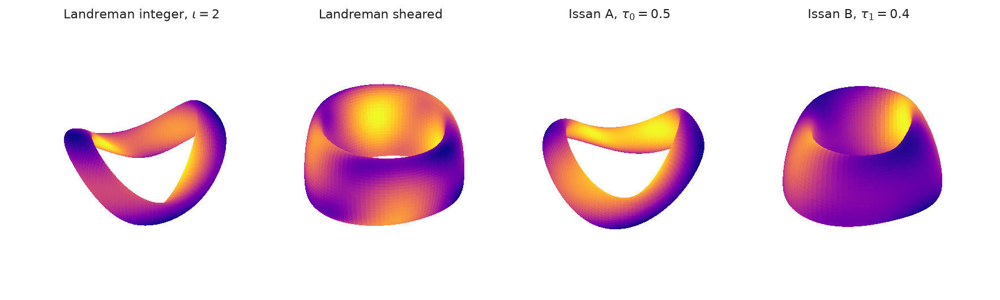

*Four of the exact boundaries, coloured by |B|. The two on the right break stellarator symmetry.*

## Main results

- **Same input, same answer.** VMEX, VMEC2000 and VMEC++ agree on every converged case; they also fail on the same ones.
- **Two VMEX defects found and fixed:** the field at the axis ([#452](https://github.com/uwplasma/vmex/pull/452)) and refinement before derivatives ([#453](https://github.com/uwplasma/vmex/pull/453)).
- **Read the field, not the file.** VMEX's continuous field gives J 10-70x more accurately than a WOUT file.
- **DESC is the most accurate here**: it gives the best sheared-A approximation (both runs stopped at DESC's 150-iteration cap, so neither counts as converged) and converges spectrally on the asymmetric family A, without the plateau VMEX shows.
- **Without stellarator symmetry** VMEX's full-basis path adds no error, mirror pairs agree to 1e-9, and the Boozer, ripple, virtual-casing, tracing and coil tools work and match the exact fields.
- **A plateau at rational transform.** With symmetry broken, VMEX's flux-surface error on the `iota = 2` family stops at about 8e-4 at NS 33, 65 and 129. Its cause is not yet established; a neighbouring equilibrium is one hypothesis among several (see open problems).

## What is compared

| Code | Version | Notes |
|---|---|---|
| [VMEX](https://github.com/uwplasma/vmex) | main `f16c300` | JAX VMEC with a continuous field and implicit derivatives |
| [VMEC2000](https://github.com/PrincetonUniversity/STELLOPT) | STELLOPT `3e1439d` | reference Fortran code |
| [VMEC++](https://github.com/proximafusion/vmecpp) | 0.5.2 | C++ reimplementation, no `LASYM` |
| [DESC](https://github.com/PlasmaControl/DESC) | `4f48720` | pseudo-spectral, Zernike basis |

**Cases.** Landreman's integer-transform and sheared families ([arXiv:2609.26742](https://arxiv.org/abs/2609.26742)), two Solov'ev tokamaks (one up-down asymmetric, derived here), and the non-stellarator-symmetric extensions of Issan et al. ([arXiv:2610.07304](https://arxiv.org/abs/2610.07304)): one parameter `tau`, with `tau` and `-tau` mirror images.

**Scores.** One script scores every WOUT: distance of each computed surface from the exact one (flux-label error), B and J errors, and the axis position.

## Results

### 1. Same input, same equilibrium

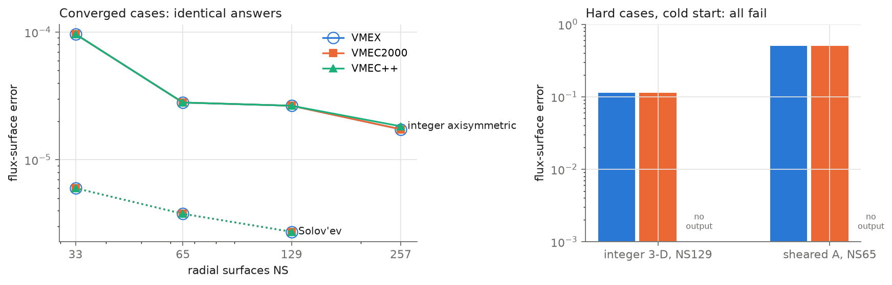

*Left: converged cases, the three codes overlap. Right: from a cold start none reaches the integer 3-D or sheared-A equilibria (label errors 0.1 and 0.5); VMEC++ writes no output.*

### 2. Two VMEX fixes

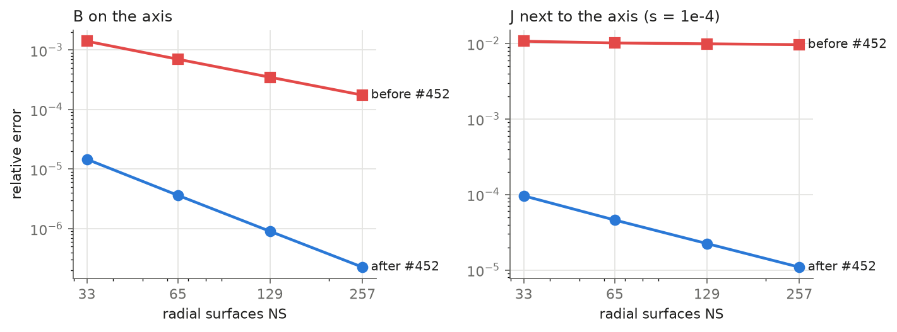

*#452: the axis value of each axis-regularized coefficient was copied, not extrapolated, so the near-axis current stayed 1 % wrong at every resolution. Exact projection, no solve.*

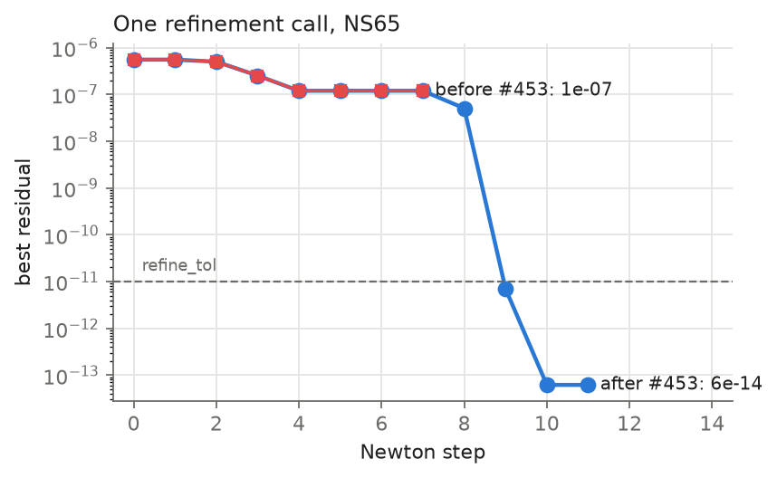

*#453: when the first Newton step overshot, refinement stopped and derivatives were taken at an unconverged state; it now restarts from its best point (1e-7 to 6e-14).*

### 3. Reading B and J

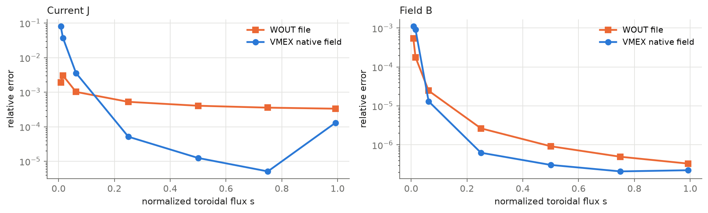

*One VMEC2000 equilibrium read two ways. Between s = 0.25 and 0.75 the native field gives J 10-70x better; within a few surfaces of the axis the WOUT current is better. A WOUT from any code can be read this way with `vmex.state_from_wout`.*

### 4. DESC

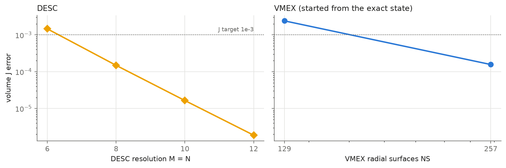

*Integer 3-D: DESC converges spectrally. For VMEX started from the exact state at NS257 the volume J error is not yet resolved: 1.6e-4 with a midpoint radial rule and 2.3e-3 with a Gauss rule, the difference coming from the cells next to the axis.*

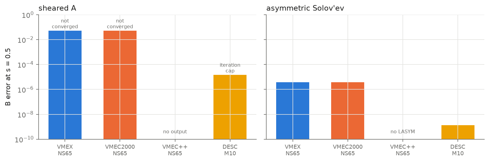

*B error on the surface s = 0.5 for every code. On sheared A only DESC gets close (1.4e-5 at M = 10, at its iteration cap); the published DESC protocol for this case meets its tolerances (B 2.2e-5 volume RMS). On the asymmetric Solov'ev case DESC is far more accurate; its basis holds this polynomial almost exactly.*

### 5. Without stellarator symmetry

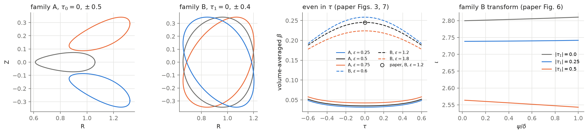

*`tau = 0` (grey) and `+-tau`; beta and iota against `tau` reproduce the paper's Figs. 3, 6 and 7. [Animation](figures/issan_tau.gif).*

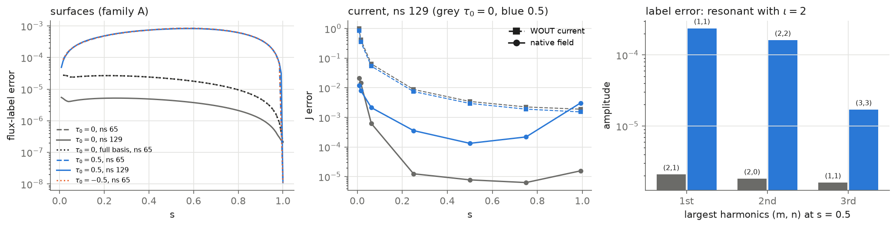

*VMEX from the exact geometry (converged to 1e-11). Left: surfaces at `tau = 0` converge with NS; at `tau = +-0.5` they stop at 8e-4, identical for the mirror pair. Middle: J from the native field is 20x better than WOUT. Right: the miss is concentrated in the (1,1), (2,2), (3,3) harmonics, resonant with `iota = 2` at two field periods. At `tau = 0` the same harmonics are present but small (for example (-1,-1) at 1.6e-6), so magnitudes alone do not settle their parity.*

The `tau = 0` equilibrium solved in the full basis matches the symmetric solve to every digit. Family B stalls at 1e-7 in VMEX even from the exact geometry.

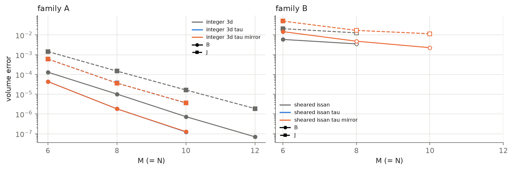

*DESC (`sym=False`). Family A converges spectrally, `tau` and `-tau` on top of each other, to B 1.2e-7 and J of order 3e-6 at M = 10 (Gauss and midpoint volume rules differ by 15%), with no plateau. Family B stays at 1e-2 to 1e-3; hollow markers did not meet DESC's own tolerance.*

### 6. `vmex --plot` on an exact asymmetric equilibrium

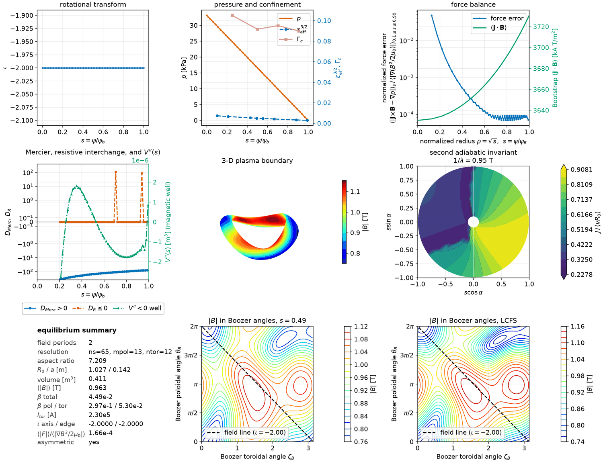

*Family A, `tau0 = 0.5`, NS 65: `iota = -2` exactly, Boozer |B| without symmetry, effective ripple, Mercier and the J invariant, from one command.*

### 7. Boozer, ripple and virtual casing

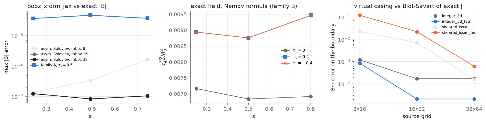

*Left: booz_xform_jax |B| against the exact field, 1e-7 on the asymmetric Solov'ev case. Middle: exact effective ripple of family B from the field itself (Nemov et al.); `+-tau1` agree to 1e-4. Right: virtual-casing B.n against Biot-Savart of the exact current, converging as fast as the symmetric cases.*

### 8. Alpha losses

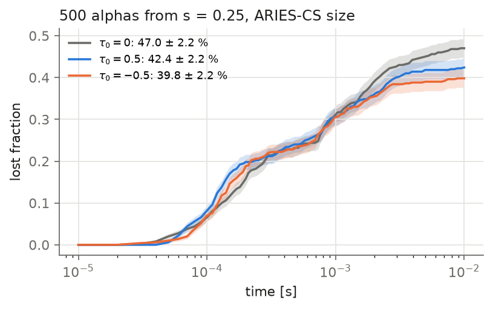 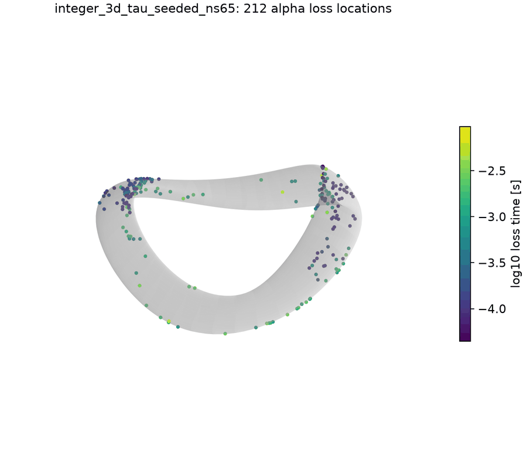

*`vmex --trace` on the VMEX equilibria, scaled to ARIES-CS size, 500 particles per case. The mirror pair loses 42.4 % and 39.8 %, 0.8 standard errors apart, consistent with the equality symmetry implies; `tau0 = 0` loses 47 %. Energy is conserved to 4e-4. This is an integration check, not an orbit verification.*

ESSOS coils for these cases reach B.n/|B| of 1e-4 to 4e-4 ([coils-for-new-landreman#1](https://github.com/rogeriojorge/coils-for-new-landreman/pull/1)).

## Open problems

- **Near-axis current in solved VMEX states**: 1e-2 in the first two or three cells at NS 129 and 257, the same in VMEC2000's solution. The exact projection does not show it, so it is not the evaluator; smoothing the first surfaces and a tighter solve did not remove it. Its cause is not yet isolated.
- **Plateau on the asymmetric integer family**: VMEX's flux-surface error stops at about 8e-4 for `tau = +-0.5` at every NS. Still to test: angular resolution, the input and seed, both closures, signed harmonic phases, and near-null directions of the constrained Jacobian.
- **Issan family B**: no code converges yet. VMEX stalls at 1e-7 from the exact geometry and DESC stays at 1e-2 to 1e-3, so the NEO_JAX and free-boundary checks on it wait on a converged equilibrium.

## Reproduce

```sh
python -m pip install -r requirements.txt
python -m pytest -q                       # exact-solution checks, about 2 minutes, no solver
python benchmarks/verify_reference.py     # force balance of every case and the Issan scans
```

With the codes installed:

```sh
python benchmarks/cross_code_run.py --deck input.integer_axisymmetric_iota --ns 129 --code vmec2000
python benchmarks/score_wout_exact.py --run-dir results/cross_code/runs/integer_axisymmetric_iota-ns129-vmec2000 --case integer_axisymmetric
python benchmarks/project_integer_vmex.py 65 --case integer_3d_tau --solve --ftol 1e-11   # VMEX from the exact geometry
python benchmarks/asymmetric.py           # scores, Boozer and resonance records
python benchmarks/desc_general_case.py --case integer_3d_tau --M 8 --output-dir <dir>
python benchmarks/plot_figures.py         # every figure, from results/ only
```

## Layout

- `benchmarks/analytic.py`: the exact solutions; `build_inputs.py` writes `inputs/`.
- `benchmarks/cross_code_run.py`, `score_wout_exact.py`, `cross_code_summary.py`: VMEX, VMEC2000 and VMEC++.
- `benchmarks/desc_general_case.py`: DESC.
- `benchmarks/boozer_exact.py`, `ripple_reference.py`, `asymmetric.py`: Boozer, ripple and non-symmetric records.
- `benchmarks/lopez_surfaces.py`: Lopez (arXiv:2610.29921v1) configuration D: exact flux map, flux-uniform angle, chart, boundary series and vacuum decks (`inputs/input.lopez_D_*`; ladders in `results/lopez/surfaces.json`).
- `results/`: receipts (input hash, code version, command) and scores. Development history: tag `archive-2026-09-25`.

## References

- M. Landreman (2026), [arXiv:2609.26742](https://arxiv.org/abs/2609.26742); supplement [landreman/analytic_3d_equilibria](https://github.com/landreman/analytic_3d_equilibria).
- W. Issan, J. Citrin, M. Landreman, B. Tracey (2026), [arXiv:2610.07304](https://arxiv.org/abs/2610.07304).
- V. V. Nemov, S. V. Kasilov, W. Kernbichler and M. F. Heyn, Phys. Plasmas 6, 4622 (1999).
- S. P. Hirshman and J. C. Whitson, Phys. Fluids 26, 3553 (1983).
- D. W. Dudt and E. Kolemen, Phys. Plasmas 27, 102513 (2020).
